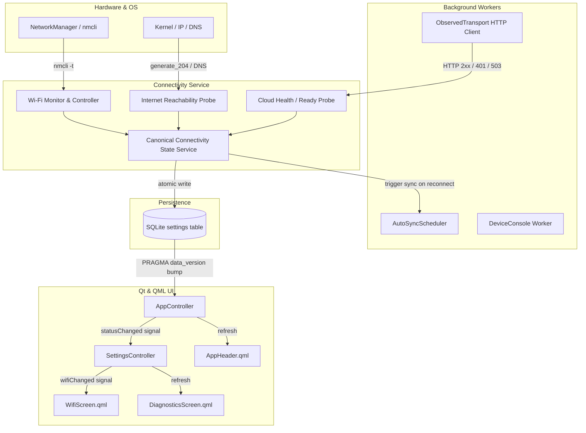

# Network & Connectivity Architecture Audit

## Executive Summary

On the Raspberry Pi Zero 2 W appliance, terminal networking operations (`ping google.com`, `curl https://startup-cloud.onrender.com/health`, and `curl https://startup-cloud.onrender.com/ready`) succeed, yet the Qt Quick / QML application reported:
- `Internet connection failed` / `Internet: Unavailable`
- `Server unavailable`
- Wi-Fi connection attempts failing in `Settings -> Wi-Fi & Network`.

This audit catalogs all implementations of Wi-Fi, Internet, Cloud, and Sync status across the codebase, identifying the architectural root causes of the discrepancy and defining the canonical fixes.

---

## Detailed State Inventory

### 1. Wi-Fi Status & Hardware Controls

| Field | Detail |
| :--- | :--- |
| **State** | Wi-Fi Association & Network Discovery |
| **Current implementation** | `app/system/wifi.py` (`WifiService`), `app/ui/device.py` (`DeviceConsole`) |
| **Actual command/API** | `nmcli --wait 10 -t -f TYPE,STATE device status` `nmcli --wait 10 -t -f SSID,SIGNAL,SECURITY device wifi list --rescan yes` `nmcli --wait 10 device wifi connect <ssid> password <pwd>` |
| **Timeout** | Subprocess timeout: 15s; NM wait: 10s |
| **Thread** | Background worker thread in `DeviceConsole._execute` (`ThreadPoolExecutor(1)`) |
| **Source of truth** | NetworkManager daemon via `nmcli` CLI subprocess; cached in `DeviceConsole.wifi_connected`, `DeviceConsole.networks`, `DeviceConsole.saved_networks` |
| **Qt property** | `SettingsController.isWifiConnected`, `SettingsController.connectedSsid`, `SettingsController.availableNetworks` |
| **QML consumer** | `WifiScreen.qml`, `SettingsScreen.qml` |
| **Problem** | 1. `connectedSsid` returned `saved_networks[0]` instead of the active Wi-Fi connection; if multiple networks were saved or none, it returned the wrong SSID or fell back to `"StudyBuddy-Home"`. 2. `WifiService.scan()` used `--rescan yes`, which fails with unprivileged polkit permissions or when wpa_supplicant rescan is busy, throwing an unhandled `RuntimeError` and crashing scan. 3. `WifiService.scan()` did not deduplicate multiple BSSIDs for the same SSID (e.g., 2.4GHz and 5GHz bands on mobile hotspot). 4. In `WifiNetwork`, signal was stored as string `signal`, but `SettingsController` looked for `signal_percent`. Security was stored as `security`, but `SettingsController` checked `encrypted`. 5. Connection timeout `--wait 10` is too short for Pi Zero 2 W Wi-Fi association and DHCP negotiation, leading to premature activation failure. 6. Subprocess error output (`stderr`) was discarded; errors such as wrong password, permission denial, or timeout were masked behind a generic exception. 7. `WifiScreen.qml` always requested a password even for open networks or already-saved networks. 8. When `availableNetworks` was empty (before first scan), `SettingsController` displayed mock sample networks (`StudyBuddy-Home`, `SchoolWiFi`), misleading the user. |
| **Fix** | 1. Implement `WifiService.connected_ssid()` using `nmcli -t -f DEVICE,TYPE,STATE,CONNECTION device status`. 2. Add fallback in `scan()` to run without `--rescan yes` if active rescan fails. 3. Deduplicate networks by SSID, selecting the strongest signal. 4. Add `signal_percent` and `encrypted` properties to `WifiNetwork`. 5. Extend connection timeout to 25s for Pi Zero 2 W. 6. Parse NM error output to classify wrong password vs. authorization vs. timeout without logging passwords. 7. Update `WifiScreen.qml` to connect directly for open or saved networks. 8. Remove fake mock networks; show real scan states (`Scanning…`, networks, or error with Retry). |

---

### 2. Internet Reachability Status

| Field | Detail |
| :--- | :--- |
| **State** | Internet Reachability (Independent of Cloud Server) |
| **Current implementation** | `app/system/wifi.py` (`WifiService.internet_status`), `app/ui/device.py` (`DeviceConsole.internet_status`) |
| **Actual command/API** | `nmcli --wait 10 -t -f CONNECTIVITY general status` |
| **Timeout** | 15s subprocess |
| **Thread** | Background worker thread in `DeviceConsole._execute` |
| **Source of truth** | NetworkManager connectivity check; cached in `DeviceConsole.internet_status` |
| **Qt property** | `SettingsController.internetStatus` |
| **QML consumer** | `WifiScreen.qml` |
| **Problem** | 1. NetworkManager's internal connectivity check is unconfigured/disabled by default on Debian / Raspberry Pi OS (`/etc/NetworkManager/NetworkManager.conf`), causing `nmcli general status` to report `CONNECTIVITY=UNKNOWN` or `NONE` even when full internet is active. 2. The Qt application never invoked `DeviceConsole.start("network")` on startup, leaving `internet_status` permanently at its initial default `"Unknown"`. 3. In `SettingsController.internetStatus`, fallback logic was `return "Available" if self.app.isOnline else "Unavailable"`, improperly coupling Internet status to Cloud online status. 4. `app/ui/screens/device_status.py` mapped `"Internet"` directly to `controller.network_label` (which is Cloud status). 5. Successful cloud sync or API traffic never updated Internet reachability to `"Available"`. |
| **Fix** | 1. Implement an independent, lightweight HTTPS/DNS internet reachability check (`generate_204` or DNS lookup with dual-stack IPv4/IPv6 support), bounded to 3–5 seconds. 2. Automatically mark Internet as `"Available"` whenever any cloud API or sync request succeeds. 3. Decouple Internet state from Cloud state across all controllers and UI screens. 4. Periodically monitor connectivity in a non-blocking background service with exponential backoff on failure. 5. Persist canonical internet state in SQLite `settings` (`connectivity_internet`). |

---

### 3. Cloud Server Status

| Field | Detail |
| :--- | :--- |
| **State** | Cloud Server Reachability & Readiness |
| **Current implementation** | `app/diagnostics.py` (`collect_network_status`), `app/connectivity.py` (`record_probe`, `ObservedTransport`, `cloud_label`), `app/ui/controller.py` (`network_label`), `app/ui_qt/controllers/app_controller.py` (`networkLabel`) |
| **Actual command/API** | `httpx.get("/health")` `httpx.get("/ready")` `httpx.get("/api/v1/content/catalog")` `httpx.get("/api/v1/device-updates/latest")` |
| **Timeout** | In `app/ui/device.py`: `connect_timeout=2`, `read_timeout=3` (too short for mobile hotspot / Pi Zero 2 W!) |
| **Thread** | Background worker thread in `DeviceConsole` or `AutoSyncScheduler`; read synchronously in UI thread via `Repository.get_setting("connectivity_cloud")` |
| **Source of truth** | SQLite `settings` table key `connectivity_cloud` |
| **Qt property** | `AppController.networkLabel`, `SettingsController.cloudStatus` |
| **QML consumer** | `AppHeader.qml`, `WifiScreen.qml`, all main screen headers |
| **Problem** | 1. The deployed cloud backend at `https://startup-cloud.onrender.com/ready` returns HTTP 503 (`migration: outdated`, `database: ok`), while `/health` returns HTTP 200 (`status: ok`). 2. In `collect_network_status`, `/ready` returning 503 caused `database_ready = False`. Then `record_probe` set state to `"Server unavailable"`. 3. Timeouts of 2s/3s in `app/ui/device.py` caused transient TLS handshakes over cellular hotspots to fail as `ConnectTimeout` / `ReadTimeout`, resulting in `backend_reachable = False` (`"Offline"`). 4. The application never scheduled periodic cloud health retries after boot; a single initial failure froze the UI state permanently at `"Server unavailable"`. 5. `ObservedTransport` only updated cloud state for authenticated requests; unauthenticated health probes or pairing calls did not record reachability. |
| **Fix** | 1. Standardize cloud semantics:    - DNS/HTTPS connection failure -> `Offline` / `Cloud unavailable`    - `/health` 200 and `/ready` 200 -> `Online` / `Ready`    - `/health` 200 but `/ready` != 200 -> `Server unavailable` (do NOT mark Internet as unavailable!)    - Authenticated API success (2xx) -> `Online`    - HTTP 401/403 -> `Authentication required` 2. Increase HTTP timeouts to 5s connect / 10s read. 3. Implement automatic periodic retry schedule with backoff (5s, 10s, 30s) so transient errors recover automatically. 4. Wrap unauthenticated reachability probes into the canonical state updater. |

---

### 4. Synchronization Status

| Field | Detail |
| :--- | :--- |
| **State** | Sync Pipeline (Idle, Syncing, Up to date, Pending, Failed) |
| **Current implementation** | `app/sync/scheduler.py` (`AutoSyncScheduler`), `app/sync/service.py` (`run_cycle`), `app/connectivity.py` (`sync_label`), `app/data/repo.py` (`count_attempts_by_sync_status`) |
| **Actual command/API** | SQLite queries on `attempts` table + HTTP POST `/api/v1/attempts`, `/api/v1/devices/heartbeat` |
| **Timeout** | `sync_connect_timeout=5.0`, `sync_read_timeout=15.0` |
| **Thread** | Dedicated daemon thread `automatic-sync` |
| **Source of truth** | SQLite `attempts` table + `settings` table keys `connectivity_sync`, `last_sync_success`, `last_sync_attempt` |
| **Qt property** | `AppController.syncLabel`, `SettingsController.syncStatusSummary`, `SettingsController.isSyncing`, `SettingsController.pendingAttemptsCount` |
| **QML consumer** | `AppHeader.qml`, `SyncScreen.qml` |
| **Problem** | 1. If device was unauthenticated (`api.store.load_safe()` is None), `AutoSyncScheduler` recorded `"Authentication required"` and halted without ever probing cloud liveness or scheduling retries. 2. When network restored after being offline, `AutoSyncScheduler` only woke up if `connectivity_cloud` was already `"Online"`, creating a chicken-and-egg problem where sync never triggered because cloud status wasn't probed, and cloud status wasn't updated because sync was idle. 3. Failed attempts were counted as pending without clear UI indication of whether auto-retry was active. |
| **Fix** | 1. Integrate `AutoSyncScheduler` with the canonical connectivity service: when Internet/Wi-Fi transitions to available/connected, trigger an immediate connectivity check and pending sync. 2. On successful sync cycle, immediately update `internet = available` and `cloud = online`. 3. Allow manual sync trigger from Settings / Sync screen to perform immediate recovery. |

---

## Canonical State Architecture

---

## Polkit & NetworkManager Authorization Matrix

| Action | Polkit Action ID | Dedicated Pi User (`aksh`) Requirement |
| :--- | :--- | :--- |
| Scan Wi-Fi networks | `org.freedesktop.NetworkManager.wifi.scan` | Required without root password |
| Connect / activate Wi-Fi | `org.freedesktop.NetworkManager.network-control` | Required without root password |
| Create / modify Wi-Fi connection | `org.freedesktop.NetworkManager.settings.modify.system` `org.freedesktop.NetworkManager.settings.modify.own` | Required without root password |
| Disconnect / delete Wi-Fi | `org.freedesktop.NetworkManager.network-control` `org.freedesktop.NetworkManager.settings.modify.system` | Required without root password |
| Enable / disable Wi-Fi radio | `org.freedesktop.NetworkManager.enable-disable-wifi` | Required without root password |

The polkit policy rule file `/etc/polkit-1/rules.d/10-studybuddy-networkmanager.rules` and legacy pkla file `/etc/polkit-1/localauthority/50-local.d/10-studybuddy-networkmanager.pkla` ensure that user `aksh` and group `netdev` are authorized for these specific actions without password prompts and without granting arbitrary root or blanket sudo.
