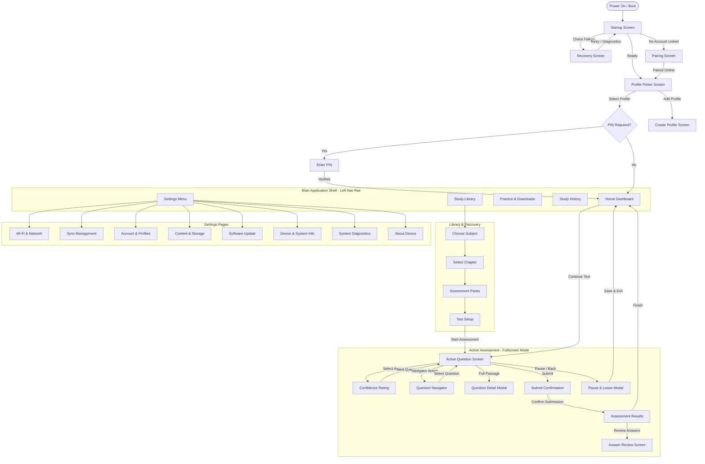

# Qt/QML UI Screen Map & Navigation Hierarchy

This document outlines the screen architecture, hierarchy, routing transitions, and QML component mapping for the Qt Quick production interface.

---

## 1. Top-Level Navigation Hierarchy

---

## 2. Screen Specifications

### 2.1 Startup & Onboarding
1. **`StartupScreen.qml`**
   - **Route**: `startup`
   - **Role**: Clean educational startup experience. Displays friendly progress ("Preparing your learning space...") and executes real diagnostic integrity checks.
2. **`RecoveryScreen.qml`**
   - **Route**: `recovery`
   - **Role**: Safe recovery fallback when local database cannot be opened or diagnostic checks fail. Non-technical, calm options ("Try Again", "Diagnostics").
3. **`PairingScreen.qml`**
   - **Route**: `pairing`
   - **Role**: First-time device connection displaying prominent 6-character code (e.g. `A7K392`), expiry timer, step-by-step instructions, and automatic background polling.
4. **`ProfilePickerScreen.qml`**
   - **Route**: `profile_picker`
   - **Role**: "Who's studying today?" card deck showing up to 3 StudyProfiles with class/grade badges and "+ Create Profile".

### 2.2 Main Dashboard & Discovery
5. **`HomeScreen.qml`**
   - **Route**: `home`
   - **Role**: Primary student dashboard. Greeting ("Good morning, Alex"), hero "Continue Practice" card with resume progress bar, and quick actions ("Browse Library", "Practice & Downloads", "History").
6. **`SubjectScreen.qml`**
   - **Route**: `subjects`
   - **Role**: High-level subject catalog cards (Mathematics, Science, English, General Knowledge) with topic counts and custom icons.
7. **`ChapterScreen.qml`**
   - **Route**: `chapters`
   - **Role**: Chapter list within the selected subject with progress and question set indicators.
8. **`PackScreen.qml`**
   - **Route**: `packs`
   - **Role**: Specific assessment pack cards showing total questions, badge types (Official, Sample, My Upload, Institute), and download/start buttons.
9. **`TestSetupScreen.qml`**
   - **Route**: `test_setup`
   - **Role**: Pre-assessment configuration. Question count chips, timer selector (No timer, 10m, 20m), mode switch (Practice / Test / Challenge), and "Start Assessment".

### 2.3 Active Assessment Flow (Fullscreen Immersion)
10. **`QuestionScreen.qml`**
    - **Route**: `question`
    - **Role**: Active question taking. Fullscreen 800×480 layout. Header with Subject, Progress indicator, Countdown Timer, and Flag button. Question text with optional images/diagrams, 4 large MCQ cards (A/B/C/D), Mark for Review button, and Next button.
11. **`ConfidenceScreen.qml`**
    - **Route**: `confidence`
    - **Role**: Metacognitive prompt after answering. Large cards: "I'm sure", "Not sure", "I was guessing", followed by smooth transition to next question.
12. **`QuestionNavigatorScreen.qml`**
    - **Route**: `question_navigator`
    - **Role**: Landscape grid overview. Left panel: summary stats (Answered, Unanswered, Flagged). Right panel: 1..N question buttons with accessible shapes and colors.
13. **`SubmitConfirmModal.qml`**
    - **Route**: `submit_confirm`
    - **Role**: Pre-submission checkpoint summarizing completed, unanswered, and flagged questions with clear "Submit" and "Review" actions.
14. **`LeaveConfirmModal.qml`**
    - **Route**: `leave_confirm`
    - **Role**: Safe exit dialog saving attempt state to local SQLite so student can resume anytime.
15. **`ResultScreen.qml`**
    - **Route**: `result`
    - **Role**: Post-assessment score summary (e.g., 8/10, 80%), confidence breakdown chart, "Review Answers", and "Back to Home".
16. **`ReviewScreen.qml`**
    - **Route**: `review`
    - **Role**: Detailed question-by-question review showing question text, student's chosen answer, correct answer, and explanation.

### 2.4 History & Settings
17. **`HistoryScreen.qml`**
    - **Route**: `history`
    - **Role**: List of completed attempts with subject, title, score percentage, date completed, and cloud sync status.
18. **`SettingsScreen.qml`**
    - **Route**: `settings`
    - **Role**: Clean settings category list (Wi-Fi, Sync, Account, Content, Updates, Device Info, Diagnostics, About).
19. **`WifiScreen.qml`**
    - **Route**: `wifi`
    - **Role**: Wi-Fi status, scan for available SSIDs, connect with on-screen keyboard, forget network.
20. **`SyncScreen.qml`**
    - **Route**: `sync`
    - **Role**: Cloud sync status, pending attempt count, "Sync Now" trigger, last sync timestamp.
21. **`AccountScreen.qml`**
    - **Route**: `account`
    - **Role**: Connected account details, registered Study Profiles, sync profiles button, unlink confirmation.
22. **`ContentScreen.qml`**
    - **Route**: `content`
    - **Role**: Storage usage bar (e.g., 12.5 GB used of 29 GB), installed packs list, downloadable packs catalog.
23. **`SoftwareUpdateScreen.qml`**
    - **Route**: `software_update`
    - **Role**: Check for signed OTA updates, download & verify update status, staging status.
24. **`DeviceInfoScreen.qml`**
    - **Route**: `device_info`
    - **Role**: App version, OS version, hardware serial, device ID.
25. **`DiagnosticsScreen.qml`**
    - **Route**: `diagnostics`
    - **Role**: Overall health assessment ("Everything looks good!"), detailed checks (System, API, DB), and "Export Support Bundle".
26. **`AboutScreen.qml`**
    - **Route**: `about`
    - **Role**: Application description, version, copyright, and licensing.
27. **`InstituteWorkScreen.qml`**
    - **Route**: `institute_work`
    - **Role**: Enrolled school/institute assignments with refresh and download triggers.
