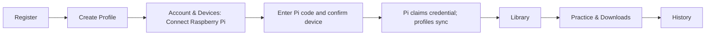
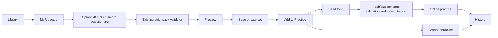

# Student workflow

## Product rules

One StudentAccount owns up to three StudyProfiles and one primary Raspberry Pi installation.
A Pi installation has one active account owner. DeviceCredential authenticates transport;
AccountDeviceLink records product ownership. Active ProfileDeviceLinks are created automatically
only after account-device authorization. No student account password is stored on the Pi.

Only active profiles count toward the three-profile limit. Archived profiles may be restored when capacity allows. Creation and restoration serialize
on the account row, including concurrent web/device requests. Existing over-limit accounts are
preserved and cannot create more profiles. Archive retains completed attempts and immutable content.

## New student



On the Pi, boot checks lead to Connect Your Device when no cached account exists. Sign in on the
website, open Account & Devices, enter the displayed code, review the device name, and confirm.
The device polls the existing claim-secret-protected pairing session, claims its transport
credential, then calls `GET /api/v1/device-account`. The account ID and active profile metadata
are cached locally; cloud-derived local IDs cannot silently adopt legacy profiles.

Account & Devices shows the account, profile count, profile management links, device connection,
last-seen time, software version and reported downloaded set count. Online means seen within
three minutes; offline means outside that window, not a claim about Wi-Fi hardware state.
Disconnect explicitly revokes ownership, transport credentials and active profile links, retaining
attempts. Another account cannot transfer a connected installation. A previously approved code
cannot authorize profiles belonging to a different owner.

## Returning Pi


Cached profiles and downloaded packs remain usable offline. Returning startup refreshes account
profiles in a background worker. A confirmed 401/403 clears the cached account routing context;
network failure retains the offline cache. Settings > Account & Profiles provides Sync Profiles,
cloud profile creation when below three, and an explicit confirmed Disconnect Device.
Creation uses `POST /api/v1/device-account/profiles`; there is no local-only creation fallback.

Normal student UI has no Development choice, Add Local Profile, Add Paired Device, or separate
manual Link Study Profile requirement. Set `ASSESS_MAINTENANCE=1` only for operator access to
preserved legacy profiles and the legacy link flow. Legacy profiles and attempts are never
assigned automatically to cloud ownership. Maintenance records retain their original identities.

## Content navigation

- **Home**: selected profile, unfinished browser practice, and links to scoped pages.
- **Profiles**: create, edit and archive cloud-owned profiles; creation remains available below three.
- **Library**: content discovery, with Browse, My Library selections, and My Uploads.
- **Practice & Downloads**: selected packs, start/continue browser practice, Pi delivery status,
  queued/downloaded/failed-retry state and available versions. The Pi's downloaded content is
  available offline through the same assessment engine.
- **History**: completed web/Pi and personal/institute attempts only, with result and answer review.
  Unfinished browser drafts appear under Continue Practice. Student-created content is identified
  in history; content versions and attempt evidence are retained across edits and archive.
- **Institute**: optional consent and assignment work scoped to the selected profile.
- **Analytics**: reserved placeholder; this change adds no analytics calculations.

## Student upload



JSON uploads use the existing schema and semantic validator, byte limit and JSON content type.
The manual builder supports single-correct A/B/C/D questions, explanations, add/remove/edit,
preview and private save. The server assigns new set IDs and versions. Edits append immutable
versions; they never rewrite a completed or in-progress attempt's content snapshot.

Student content belongs to StudentAccount, is private by default, and is available only to that
account's profiles. The same private storage and profile delivery endpoints handle official and
private packs. Legacy all-device catalogues and institute assignment catalogues exclude private
student packs. Another student's catalogue, upload read/edit/archive, practice and download
requests cannot use those packs. Browser and Pi clients never receive storage service keys.

PDF resources are deferred: current QuestionPack/ContentVersion, scoring and delivery contracts
require validated JSON assessments. Safe arbitrary object storage alone does not supply a
reference-resource domain model, resource authorization, viewer, or Pi resource contract. No
PDF-to-MCQ conversion is implemented.

## Four demo sets

`content/sample_set_1.json` through `sample_set_4.json` each contain five supported Biology MCQs
with explanations, labeled Sample / Demo Content. These are testing fixtures, not reviewed
production educational content.

After migrating a local development database, explicitly run:

```powershell
python -m backend.tools.seed_demo_library
```

It is idempotent, restricted to nonproduction settings, and is never called by application startup.
To remove the sets from discovery without destroying historical evidence:

```powershell
python -m backend.tools.seed_demo_library --remove
```

Archived demo identities are retained; repeated seeding does not silently restore archived sets.

## Migration and operations

`20261029_04` follows production head `20261029_03`. It adds AccountDeviceLink and nullable
QuestionSet ownership plus archive state without resetting existing tables/data. Its downgrade
refuses to remove ownership or private-content data. Existing installations require their prior
runtime grants plus the new migration. The new table enables RLS, blocks PUBLIC/anon/authenticated,
and conditionally grants SELECT/INSERT/UPDATE with operation-specific policies to an existing
restricted `assessment_backend` role. It grants the account `updated_at` column needed by the
serialized profile creation operation. If the runtime role is provisioned after migration, its
new-table grants/policies must be provisioned before serving requests.

No production migrations, deployments, commits, pushes or physical Pi changes are part of local
acceptance. PostgreSQL permissions must be tested with a restricted role in a disposable database.

## Verification

From `startup-cloud`, cloud: `python -m pytest`, `python -m ruff check backend shared`.
Device: `python -m pytest`, `python -m ruff check app tests`.
Set `DEVICE_REPO_PATH` to the independent device checkout for real-client cross-repository tests.
Use a disposable `TEST_DATABASE_URL` for PostgreSQL suites. The restricted-role test additionally
needs `WORKFLOW_TEST_ADMIN_URL` pointing to a disposable local PostgreSQL administrator able to create a temporary database and role. The six new workflow API cases run on both SQLite and isolated PostgreSQL databases when this variable is set.
Web: `npm test`, `npm run lint`, `npm run typecheck`, `npm run build`;
Playwright: `node tests/student.browser.mjs`, `practice.browser.mjs`, `institutes.browser.mjs`.
`PLAYWRIGHT_MODULE` can point at the bundled Playwright package.


## Product consistency revision — 30 October 2026

See [current state and reconciliation contract](PRODUCT_STATE_CONTRACT.md) for connection verification, active-profile capacity/restore, durable receipt/download/install acknowledgements, offline state and deployment order. Earlier phase reports describe historical behavior.
