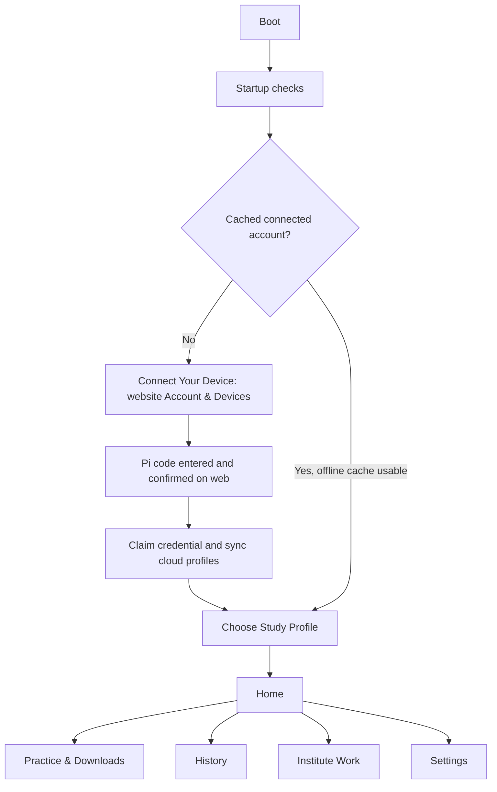

# Consolidated student UI flow

See [STUDENT_WORKFLOW.md](STUDENT_WORKFLOW.md) for the current product model and setup contract.



Settings: Account & Profiles, Wi-Fi, Sync, Content & Downloads, Software Update, Device,
Diagnostics, About. Account & Profiles provides cloud profile creation, Sync Profiles and
confirmed Disconnect Device. No normal anonymous profile creation or manual per-profile pairing.

Cached cloud profiles, downloaded questions, paused attempts, result and answer review remain
usable offline. Account refresh requires network and never silently adopts legacy profiles.
Legacy operator flows require `ASSESS_MAINTENANCE=1` and retain their original records.

## Input and layout

The logical canvas is 800 × 480 and is scaled to the display window. Colours and typography live
in `app/ui/theme.py`. Fonts and bounded label surfaces are cached. The event loop redraws after
input, a device-job completion, a resize, or a timer-second change; there is no continuous animation.

Touch/finger input and mouse hit targets emit the same `Action` plus optional UI payload as keyboard
and GPIO input. Synthesised touch mouse events are ignored to prevent a single tap being processed
twice. GPIO is opt-in and uses the existing button adapter; callbacks post events to the GUI thread.

- Questions: A/B/C/D or 1/2/3/4 answer; Left/Right previous/next; R review flag; M menu.
- Confidence: A/B/C or S/N/G select Sure/Not Sure/Guessing; Back returns to options.
- Lists: Left/Right choose, A or Enter select, M/Escape back.
- Submit: A/Enter continues the test; T or the labelled touch target performs final submission.
- Text entry: type normally on a keyboard, or use the on-screen keys. GPIO Left/Right chooses
  a character, A types it, B deletes, C changes key sets, D confirms, Menu goes back.
- Full text: Left/Right changes page, A/Menu/Back returns. Page counts derive from all content.
- F12 saves a local screenshot under `var/screenshots`.

Every emitted touch target is at least 48 × 48 logical pixels. Headers and contextual physical-button
footers are persistent. Long question/option bodies scroll; full-text pages expose all text without a
fixed three-page limit. Review explanations scroll and are also available in full text. Navigator
buttons are paged in groups of 40 and use `+` answered, `-` unanswered, `*` review, `>` current as
well as colour and border changes. Diagram paths are confined to the configured media root,
file/pixel sizes are bounded, and scaled surfaces are cached. Missing media has an explicit state.

## Assessment boundaries

Only `AssessmentApplication` writes assessment events and transitions the engine. The UI does not
execute SQL or calculate scores. Result accuracy, correctness counts, confidence matrices and
priority-review IDs come from the engine's `ScoreResult`. Local History shows the most recent 20
completed attempts for the selected profile, using persisted scores and sync state.

An in-progress attempt always resumes its exact stored version and question order. The existing
engine allows one in-progress attempt per profile. Start New explains that the existing test must
be finished; it never abandons or replaces that attempt. Leaving for Home requires a confirmation
and pauses/saves timing. Closing and restarting preserves answers, confidence and review flags.

## Device services

`DeviceConsole` runs bounded operations on a daemon worker. Each operation that needs SQLite opens
its own repository connection; it never passes the GUI connection to a thread. Results are applied
on the main thread. The assessment can continue while a network request fails or is waiting.

- Wi-Fi uses argument-array NetworkManager calls with timeouts. Saved networks, scanning,
  password entry, connect and forget stay in the UI. Missing NetworkManager is a visible state.
  Association and internet/API reachability are checked separately.
- Pairing reuses `PairingClient` and `CredentialStore`; only the user pairing code is displayed.
  Polling is bounded, expiry is handled, and cancelling invalidates pending results/credential saves.
  Cached account-owned profiles remain available offline. Disconnect Device has an explicit confirmation.
- Sync reuses `SyncWorker`, preserving retry/idempotency behavior and local assessment independence.
- Content uses `ContentApiClient` and the existing download/hash/schema/atomic-import pipeline.
  Local versions remain listed and usable. Fetched remote metadata adds catalogue entries without
  hiding local content. Download, update, validation failure and unavailable-offline states are shown.
- Software update uses `UpdateClient`, `verify_update` and `stage_update`. Install & Restart remains
  disabled: the existing activation service updates release metadata but this checkout has no
  boot/restart launcher that consumes it. This UI does not pretend to have installed a staged release.
- Diagnostics reuses `collect_device_status`; support export reuses `create_support_bundle`.
  Account/device screens show only pairing state and a shortened ID, never token or secret paths.

## PIN integration limit

The existing checkout contained nullable `pin_hash` / `pin_salt` columns but no PIN verifier,
provisioning UI, hash-format contract or lockout implementation. The repository now exposes these
fields through a read-only accessor; SQL remains in the data layer. The verifier accepts explicitly
encoded `pbkdf2_sha256$iterations$hex_digest` values with the separately stored UTF-8 salt, bounds
iterations to 100,000–1,000,000, compares in constant time, and persists escalating lockout after
five failures. No existing hashes are rewritten. Unknown/opaque formats stay locked and show
recovery guidance. Cloud profile creation does not provision a local PIN; PIN provisioning is not supplied by this UI.
Confirm the deployed provisioning format before claiming compatibility with existing protected Pi
profiles. Do not treat the test format as proof of that deployment policy.

## Verification

```powershell
.\.venv\Scripts\python.exe -m pytest -q
.\.venv\Scripts\python.exe -m ruff check .
.\.venv\Scripts\python.exe -m tools.ui_smoke
```

`ui_smoke` uses a temporary real repository and the shipped sample question pack. It generates
24 800 × 480 previews and a contact sheet under `artifacts/ui-redesign`, without opening or changing
student data. Automated tests exercise real engine/repository transitions, restart/version pinning,
startup/recovery, settings navigation, touch bounds, long text, PIN lockout, background failure,
local diagnostics/support export, catalogue states and large question navigators.

Pi display/touch/GPIO, NetworkManager permissions, actual server pairing/sync/download,
release activation/restart and on-device performance require device acceptance testing.
No remote deployment or Pi test is implied by local previews or the headless entry-point tests.
